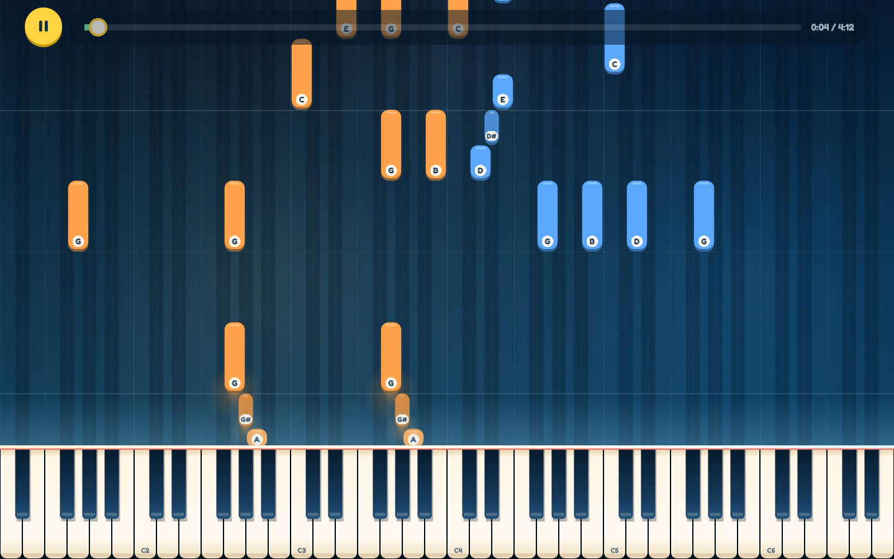
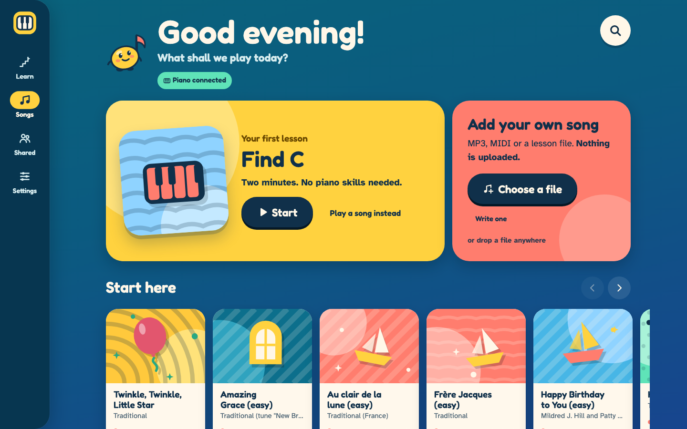
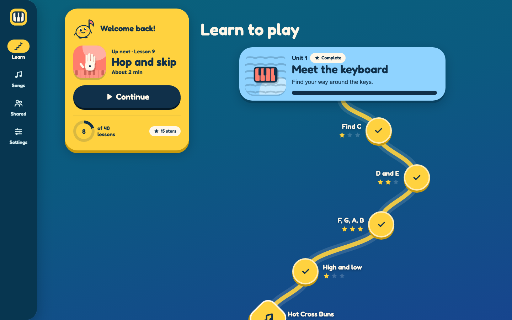
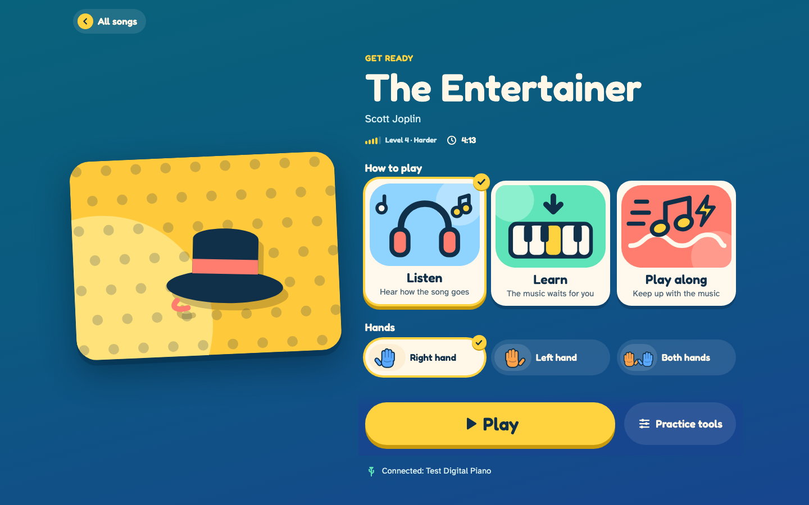
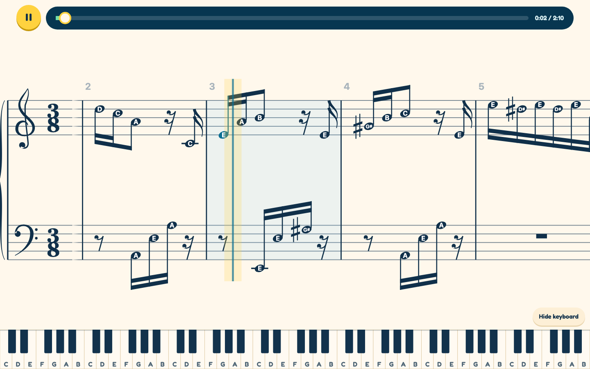
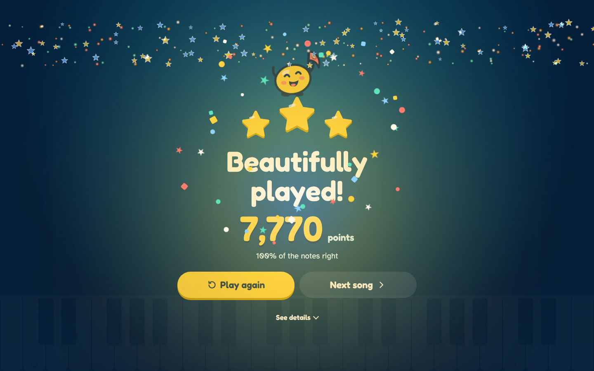
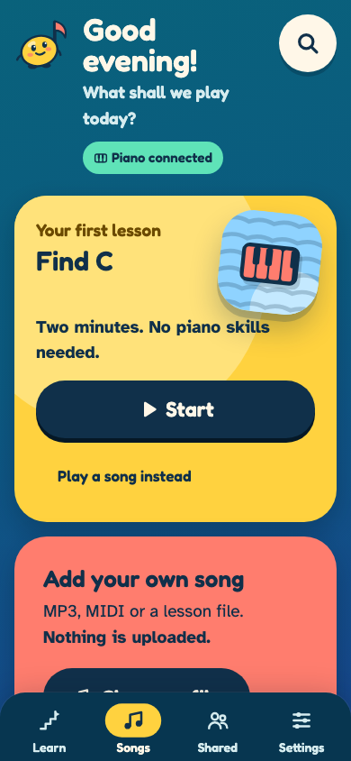

<h1 align="center">Piano</h1>

<p align="center">
  <b>Learn piano with any song you own. Free, open source, nothing uploaded.</b><br>
  Plug in a keyboard, drop in an MP3, and play along with the original recording.
</p>

<p align="center">
  <a href="https://sabalys-ramunas.github.io/open-piano/"><b>▶ Try the live demo</b></a><br>
  <sub>Best in Chrome or Edge on a computer. Alpha: expect bugs.</sub>
</p>

<p align="center">
  
</p>

> [!WARNING]
> **This is a first alpha (0.0.1). Expect bugs.**
> The course, the built-in songs and playing with a USB keyboard in Chrome work well. Turning your own recording into a lesson is the exciting part and also the roughest: notes and chords are often wrong, and it has only been tried on a handful of songs. The iPad app has never been run on a real iPad. See [What works and what does not](#what-works-and-what-does-not) before you judge it.

## The idea

Piano apps that listen to your keyboard and teach you with falling notes are great, and they cost a subscription, and they only teach the songs in their catalogue.

This project is the opposite bet:

1. **Any song becomes a lesson.** Add a recording from your own files. The app listens to it on your device, works out the tune and the chords, and builds a piano part at the level you choose.
2. **You play along with the real recording**, not a beepy copy. The app can split the song and take out the guitars and keys, so your piano replaces them while the singer, bass and drums keep going.
3. **Lessons are shared as notes only.** A lesson file holds notes and timing, never audio. Someone fixes a song by hand, shares the small file, and anyone who owns the same recording can play it. Think of how rhythm game communities share song maps.
4. **Free forever.** No account, no adverts, no tracking, no trial. Everything runs in your browser and your songs stay on your device.

It is made for everyone, including children and complete beginners.

## A look around

| | |
|---|---|
|  |  |
| **Home.** A first lesson, your songs, and one button to add a recording. | **A course** of 40 short lessons, from finding C to playing with both hands. |
|  |  |
| **Three ways to play:** Listen, Learn (the music waits for you) and Play along. | **Sheet music** if you prefer it to falling notes. |
|  |  |
| **Stars, points and a cheer** at the end. | **Phones and tablets** too. |

## What works and what does not

Honest status, as of this alpha.

### Works well

- The **course**: 9 units, 40 lessons, with stars and a daily streak.
- **74 included songs**, from nursery tunes to Bach, Chopin, Joplin and Satie, many with an easy version.
- **USB MIDI keyboards** in Chrome, Edge and Opera on a computer and in Chrome on Android: notes, how hard you press, and the sustain pedal.
- **Falling notes and sheet music**, right hand, left hand or both.
- **Practice tools:** slow down, loop a part, loop your last mistake, "Show me", a coach for the trickiest part, count-in and metronome.
- **A note editor** to fix or write a song, or record one from your piano.
- **Offline** after the first visit, and installable from the browser menu.

### Rough

- **Recording to lesson.** The tune is often close; the rest is hit and miss. Songs with a quiet singer or a busy mix come out poorly.
- **Chords from a recording.** The piano part built from guitar or band chords can sound clumsy, and some chords are simply wrong. This is the part that most needs work.
- **Song splitting** (taking out the guitars and keys). It runs, but it has only been measured on artificial test songs. It needs an 80 MB download the first time and about 2 GB of memory while it works, which may be too much for older tablets.
- **Long songs** could stutter in Listen mode. This was reworked, but not yet confirmed on slow machines.
- **Microphone input** for acoustic pianos works best one note at a time and was tested with generated tones, not many real pianos.
- **Sheet music** has no triplets or swing, and one voice per staff.
- **Some traditional tunes** were written from memory and need checking by ear.

### Not tested yet

- **The iPad and iPhone app** (in `ios/`). It builds and starts in the simulator. It has never run on a real device or with a real keyboard.
- **Safari.** It is tested in Safari's engine by machine, not by people. Safari has no Web MIDI, so no cable connection there.
- **Bluetooth MIDI keyboards.**

Found something broken? That is expected, and an issue with the song style and your browser is a real help.

## Try it

The quickest way is the [live demo](https://sabalys-ramunas.github.io/open-piano/). Nothing you add there is uploaded; it all stays in your browser.

To run it yourself you need [Node.js](https://nodejs.org/) 20 or newer.

```bash
npm install
npm run dev        # start a local server and open the address it prints
```

Then press "Connect my piano", or use your computer keyboard or the on-screen keys.

```bash
npm test           # unit tests (one listens to real audio and takes about a minute)
npm run build      # type-check and build the site into dist/
npm run e2e        # browser tests; first run: npx playwright install chromium
```

`dist/` is a static site: put it on any web host. Connecting a piano needs a secure page, so serve it over `https` (or from `localhost`).

The browser tests are silent on purpose: nothing plays through your speakers.

### iPad and iPhone

Browsers on iPad and iPhone cannot talk to a MIDI keyboard, so `ios/` holds a small native shell that shows the same web app and passes the keyboard's notes to it. You need a Mac with Xcode and an Apple developer account. Steps are in [`ios/README.md`](ios/README.md).

## Browser support

| Browser | Piano over USB | Everything else |
|---|---|---|
| Chrome, Edge, Opera on a computer | Yes | Yes |
| Chrome on Android | Yes | Yes |
| Firefox on a computer | Yes, after you allow the site permission add-on Firefox offers | Yes |
| Safari on a Mac | No. Use the computer keyboard, the on-screen keys or the microphone | Yes |
| Any browser on iPhone or iPad | No. Use the app in `ios/`, the on-screen keys or the microphone | Yes |

## Adding your own songs

- **Recordings:** MP3, M4A, AAC, WAV, OGG, Opus, FLAC, WebM, and the sound of many video files. You choose how much to play: melody only, melody and bass, melody and chords, or everything.
- **MIDI files** and **lesson files** open directly.
- **Splitting** is offered when you add a recording. In the player you then choose "Full song", "Without guitars and keys" or "Piano only".

Nothing you add leaves your device. The note detection and the splitting both run in your browser.

## Sharing lessons

A lesson file holds **notes only**: the notes, their timing, which hand plays them, and a few details (title, artist, level, licence, credit). It never contains a recording, lyrics, images or links.

- In the player, "Save lesson" downloads a lesson file you can send to anyone.
- A lesson made from a recording names that recording (file name and size) so the other person can add their own copy. The recording itself is never shared.
- The "Shared songs" screen reads a catalog of lessons. The format and how to submit one are in [`community/README.md`](community/README.md) and [`community/CONTRIBUTING.md`](community/CONTRIBUTING.md).
- What may be shared, and how rights holders can ask for a removal, is in [`community/POLICY.md`](community/POLICY.md). In short: public-domain music, your own music, or openly licensed music.

## Where this is going

- Chords and piano parts that sound like a pianist wrote them.
- Reading the tune from the separated voice instead of the whole mix.
- A public catalog where people share and improve lessons.
- A proper iPad release once it has been tested on real devices.
- A real name. "Piano" is a placeholder, set in one place: `src/app/brand.ts`.

## Contributing

Help is welcome, most of all on the rough list above. See [CONTRIBUTING.md](CONTRIBUTING.md); the code is laid out in [docs/architecture.md](docs/architecture.md).

The most useful thing you can do today costs no code: try a song you own, and open an issue saying what kind of song it was and what came out wrong.

## Credits and licences

The code is released under the [MIT licence](LICENSE). Bundled content carries its own licences; the full list with every attribution is in [THIRD_PARTY_NOTICES.md](THIRD_PARTY_NOTICES.md).

- **Piano sound:** Salamander Grand Piano V3 by Alexander Holm, [CC BY 3.0](https://creativecommons.org/licenses/by/3.0/), as a trimmed, re-encoded subset.
- **Songs:** classical pieces come from editions on the [Mutopia Project](https://www.mutopiaproject.org/). Most are public domain; some are Creative Commons Attribution-ShareAlike and stay under that licence with credit to the typesetter. Traditional tunes and easy versions were arranged for this app and are released under [CC0 1.0](https://creativecommons.org/publicdomain/zero/1.0/). Every song shows its licence and credit in the app.
- **Note detection:** [Basic Pitch](https://github.com/spotify/basic-pitch) by Spotify, Apache License 2.0, run with [TensorFlow.js](https://www.tensorflow.org/js).
- **Song splitting:** [Spleeter](https://github.com/deezer/spleeter) by Deezer Research, MIT, run with [ONNX Runtime Web](https://onnxruntime.ai/). The model is downloaded on first use and is not part of this repository.
- **MIDI files** are read with [@tonejs/midi](https://github.com/Tonejs/Midi) (MIT).

This project is not affiliated with any commercial piano learning app.
